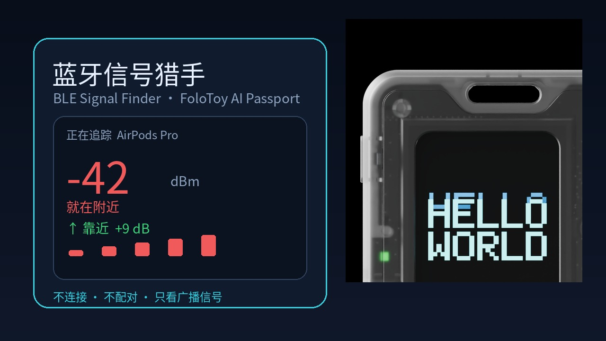

# BLE Signal Finder for FoloToy AI Passport

<p align="center"></p>

[README.md](README.md) · English · [简体中文详版](README.zh_CN.md) · [Community metadata](docs/release/community-metadata.md) · [Release notes](docs/release/RELEASE_NOTES.md)

Turn an AI Passport into a pocket signal detector for phones, earbuds, tags, and any other BLE advertiser. It listens to broadcast packets only: **no connection, no pairing, no changes to the target device**.

> RSSI is relative, not a distance meter or a compass. This app turns “the signal gets stronger when I walk this way” into fast, readable, audible feedback so you can narrow the search quickly.

## Features

- Continuously scans BLE advertisements and shows a readable label (inferred from manufacturer data, Appearance or service UUID when no Local Name is broadcast), filtered dBm, and a strength bar. The list keeps a stable order and never reshuffles on RSSI jitter.
- Select a device with UP/DOWN and lock it with OK; the target and preferences persist across reboots.
- Tracking screen shows:
  - a large dBm reading;
  - five signal levels (OUT / FAR / NEAR / CLOSE / VERY CLOSE);
  - **CLOSER ↑ / AWAY ↓ / STABLE →** trend with approximate delta;
  - dynamic hints telling you whether to roam or turn around.
- Procedurally generated audio cues, no external sound assets:
  - faster beeps as you get closer;
  - distinct tones for trend changes, locking, settings, and very-close confirmation.
- Four settings: sound, volume, name matching, and filter profile (FAST / NORMAL / STABLE).
- A generated Chinese bitmap font is bundled; no phone or cloud dependency at runtime.

## What v1.0.1 fixes

Community review asked for the LVGL task to yield CPU to IDLE, and real-device testing also showed a jumping list, MAC-only rows, and frequent "no signal" right after locking. v1.0.1 addresses all four:

- **CPU yield**: the main loop drains at most 8 events per pass and always calls `vTaskDelay(1)`; advertisements are coalesced per address at about 10 Hz so the event queue cannot flood.
- **Stable list**: ordering uses a smoothed key with 12 dB hysteresis and first-seen order; the cursor follows a device address instead of a row index, so OK always locks the highlighted device.
- **Readable labels**: a total AD-structure decoder never drops a report on malformed data, and infers an ASCII device label from manufacturer data, Appearance and 16-bit UUIDs.
- **Reliable tracking**: the target owns an independent filter that survives list eviction, inherits samples collected on the scan screen, and uses freshness windows long enough for phones and earbuds advertising every 1-3 s.

Regression coverage lives in `tests/test_finder_stability.c` and `tests/test_device_label.c`; both `./tests/run_host_tests.sh` and `./tools/validate.sh --static` pass.

## Controls

| Screen | UP / DOWN | OK tap | OK hold |
| --- | --- | --- | --- |
| Scan list | Move selection | Lock selected target | Open settings |
| Tracking | Adjust volume | Back to scan list | Open settings |
| Settings | Move focus | Change value | Back |

On boot the last target is restored automatically. If it is advertising, the app enters tracking directly.

## How it works

1. NimBLE Observer scans every 100 ms. It never creates a link.
2. Each device gets a 7-sample median, Q8 exponential low-pass, 4–5 dB hysteresis, and a freshness timeout.
3. Trend compares filtered RSSI over roughly 1.8–2.4 s and flips only beyond ±4 dB, preventing jitter while walking.
4. After the target is unseen for 1.5–2 s (profile dependent), the UI returns to OUT and tells you to keep moving.
5. Phones may rotate their MAC. Enable “name match” to follow the advertised name; this can lock onto a different device with the same name, so use it only when helpful.

There is no IMU, so the app does not claim step counting. Feedback comes from advertisement refreshes and signal trend. Turn earbuds on and wake the phone screen before searching.

## Build

ESP-IDF 5.5.3 is required:

```bash
. $IDF_PATH/export.sh
idf.py set-target esp32c3
idf.py build
bash tests/run_host_tests.sh
ACTIONLINT=offline ./tools/validate.sh --static   # offline mode; drop the prefix when online
./tools/validate.sh --firmware                    # independent full build, merge, verify, archive
```

Community publishing must use the merged image produced by `./tools/validate.sh --firmware`, not the bare application image.

### Firmware artifact

| Item | Value |
| --- | --- |
| Merged image | `build/FoloToy-AI-Passport-full.bin` |
| Size | 1,013,328 bytes |
| SHA-256 | `b9589914dbf130234dc61cf6fffcdc626b0efd318d7d16b57c91247218a1e78a` |
| Flash offset | `0x0` |
| App partition | `factory` @ `0x10000` |
| App size | 947,792 bytes |

Flash the merged image at `0x0`. Merged flashing may reset stored data on the device; this is expected.

## Test status

- `Build`: PASS (ESP-IDF 5.5.3 build)
- `Host tests`: PASS (filter, state machine, audio synthesis, host simulator, glyph coverage, repository checks)
- `Static checks`: PASS in `ACTIONLINT=offline` mode; `actionlint` itself was not run
- `Firmware gate`: PASS (`./tools/validate.sh --firmware`: full build, merge, layout verification, debug archive)
- `Device tests`: NOT RUN (no hardware in the delivery environment and no flashing authorization)
- `Unverified`: on-device RF behavior, actual advertisement intervals of specific phones/earbuds, speaker loudness, LCD font rendering, NVS persistence after power loss; GitHub Actions YAML was not linted because actionlint was skipped offline.

`simulator/simulation.log` covers discovery, lock, approach, retreat, target loss, and a settings round-trip.

PassportSim disables the real BLE controller, so `sdkconfig.defaults.simulator` replaces only the radio source with deterministic synthetic advertisements. UI, model, filtering, audio, and buttons are identical to the release build. See `simulator/ui_scan.png`, `simulator/ui_track.png`, and `simulator/ui_settings.png`. Do not publish the QA image.

## License

MIT. Fonts are generated from Noto Sans CJK SC under the SIL Open Font License 1.1; see `assets/fonts/OFL.txt`.
