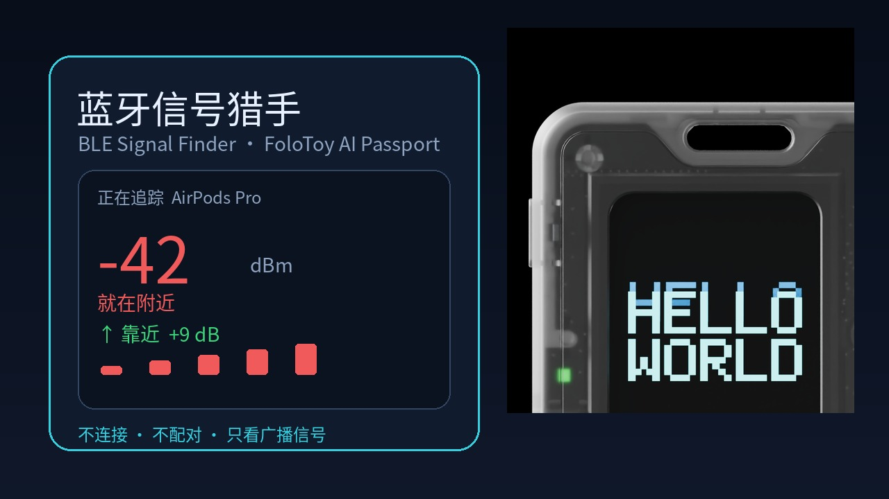

# 蓝牙寻物探测器 / BLE Signal Finder

<p align="center"></p>

[English](README.en.md) · 简体中文 · [简体中文详版](README.zh_CN.md) · [社区元数据](docs/release/community-metadata.zh_CN.md) · [发布说明](docs/release/RELEASE_NOTES.zh_CN.md)

把 FoloToy AI Passport 变成一台**真正能找手机、蓝牙耳机、蓝牙标签等广播设备**的随身信号探测器。它只监听 BLE 广播包，**不连接、不配对、不改目标设备任何设置**。

> RSSI 只能反映相对远近，不能给出精确米数或方向。这个应用把“走动时信号变强/变弱”做成清晰、及时、可听可见的反馈，用来快速缩小搜索范围。

## 功能

- 扫描周围 BLE 广播设备，显示可读设备名（没有广播名时按厂商数据、外观、服务 UUID 推断，如 `Apple Earbuds 4C:19`）、滤波后的 dBm 和强度条；列表按首次发现顺序稳定排列，不会随信号抖动上下跳。
- 上下键选中目标，按 OK 锁定；目标与偏好设置掉电保存。
- 追踪界面同时给出：
  - 大号 **dBm 数值**；
  - 5 级信号强度（未发现 / 尚远 / 接近 / 很近 / 就在附近）；
  - **靠近 ↑ / 远离 ↓ / 稳定 →** 趋势和近似变化量；
  - 动态提示语，告诉你该大范围走动还是原地转身。
- 程序化合成提示音，不需要外部音频素材：
  - 越近提示音越密；
  - 趋势变化有独立音调；
  - 锁定、设置、极近确认都有反馈。
- 4 档设置：提示音开关、音量、名称匹配、滤波档位（快速 / 标准 / 稳定）。
- 中文点阵字体子集随固件内置，不依赖手机或云端。

## v1.0.1 修了什么

社区审核反馈「画面卡住」，实机还出现列表乱跳、只有 MAC、锁定后常报无信号。这一版把四个问题一起修掉：

- **主循环让出 CPU**：每轮最多处理 8 个事件并固定 `vTaskDelay(1)`，IDLE 与 LVGL 刷新任务不再被密集广播饿死；广播按地址约 10 Hz 合并，事件队列不再溢出。
- **列表不再跳**：排序键改用带 12 dB 滞回的平滑值，光标绑定设备地址而不是行号，OK 锁定的一定是高亮那台。
- **看得懂设备名**：换成容错 AD 结构解析，解析失败也不丢 RSSI；无名设备从厂商数据 / Appearance / 16-bit UUID 推断类型并给出 ASCII 标签。
- **追踪不掉线**：目标使用独立滤波器，不再受 12 行列表淘汰影响；未收到广播的超时放宽到适配手机、耳机 1–3 秒的广播间隔，并区分「正在锁定 / 信号不稳 / 离开范围」。

对应回归测试：`tests/test_finder_stability.c`、`tests/test_device_label.c`；`./tests/run_host_tests.sh` 与 `./tools/validate.sh --static` 均可通过。

## 交互

| 屏幕 | 上 / 下 | OK 单击 | OK 长按 |
| --- | --- | --- | --- |
| 扫描列表 | 选择设备 | 锁定该设备并开始追踪 | 进入设置 |
| 追踪 | 调节音量 | 返回扫描列表 | 进入设置 |
| 设置 | 选择设置项 | 修改当前项 | 返回上一屏 |

应用启动后会自动恢复上次锁定的目标；如果目标正在广播，直接进入追踪界面。

## 它如何工作

1. NimBLE Observer 以 100 ms 间隔持续扫描广播，不建立连接。
2. 每台设备独立维护：7 点中值 + Q8 指数低通 + 4~5 dB 迟滞 + 超时重置。
3. 趋势用最近约 1.8~2.4 秒的滤波值比较，超过 ±4 dB 才翻转，避免走路抖动导致乱跳。
4. 目标丢失超过 1.5~2 秒（按档位）后，界面回到“未发现”，提示继续移动。
5. 手机/macOS/iOS 可能使用随机 MAC；在设置里打开“名称匹配”后，可按广播名称持续跟随。名称匹配会增加同名设备误锁定的可能，请按现场情况选择。

**没有 IMU，所以不会声称“计步”；反馈来自广播包刷新和信号趋势。** 通常手机隔几秒广播一次，耳机、AirTag 类标签广播更密；使用前让耳机开机、手机亮屏。

## 构建

需要 ESP-IDF 5.5.3：

```bash
. $IDF_PATH/export.sh
idf.py set-target esp32c3
idf.py build
bash tests/run_host_tests.sh
ACTIONLINT=offline ./tools/validate.sh --static   # 离线环境；联网时可去掉前缀
./tools/validate.sh --firmware                    # 独立全量构建 + 合并 + 校验 + 归档
```

官方发布请使用 `./tools/validate.sh --firmware` 产出的合并镜像，不要直接用应用单镜像替代。

### 固件产物

| 项目 | 值 |
| --- | --- |
| 合并镜像 | `build/FoloToy-AI-Passport-full.bin` |
| 大小 | 1,013,328 字节 |
| SHA-256 | `b9589914dbf130234dc61cf6fffcdc626b0efd318d7d16b57c91247218a1e78a` |
| 烧录偏移 | `0x0` |
| 应用分区 | `factory` @ `0x10000` |
| 应用大小 | 947,792 字节 |

合并镜像从 `0x0` 烧录。合并烧录可能重置设备内已存数据，属于正常现象。

## 测试状态

本仓库在交付时执行了：

- `Build`: PASS（ESP-IDF 5.5.3 编译）
- `Host tests`: PASS（滤波、状态机、音频合成、宿主模拟器、字形覆盖、仓库检查）
- `Static checks`: PASS（`ACTIONLINT=offline` 下运行；`actionlint` 未执行）
- `Firmware gate`: PASS（`./tools/validate.sh --firmware`：全量构建、合并镜像、布局校验、调试归档）
- `Device tests`: NOT RUN（交付环境无实体设备，且未获得烧录授权）
- `Unverified`: 真机射频表现、具体型号手机/耳机的广播间隔、扬声器听感、LCD 字体实际显示、NVS 掉电恢复；`actionlint` 在离线模式跳过，GitHub Actions YAML 未做语法检查。

`simulator/simulation.log` 是宿主模拟器输出，覆盖：发现设备 → 锁定 → 走近 → 远离 → 目标消失 → 设置往返。

PassportSim 网页模拟器本身关闭了真实 BLE 控制器，因此额外提供 `sdkconfig.defaults.simulator`：仅把射频源替换为确定性的模拟广播，UI、状态机、滤波、音频和按键路径都与正式版相同。截图见 `simulator/ui_scan.png`、`simulator/ui_track.png`、`simulator/ui_settings.png`。该 QA 固件不用于发布。

## 许可证

MIT。字体文件由 Noto Sans CJK SC（SIL Open Font License 1.1）转换生成，仅包含应用所需字形；字体许可证见 `assets/fonts/OFL.txt`。
