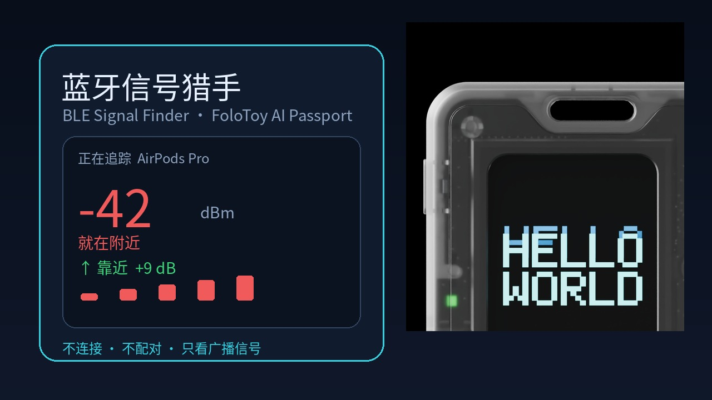

# 蓝牙信号猎手（BLE Signal Finder）

<p align="center"></p>

[README.md](README.md) · [English](README.en.md) · 简体中文 · [社区发布元数据](docs/release/community-metadata.zh_CN.md) · [发布说明](docs/release/RELEASE_NOTES.zh_CN.md)

一个可直接发布到 FoloToy AI Passport 玩法社区的开源寻物固件：只监听蓝牙广播，不配对、不连接，就能跟着信号强弱找到耳机、手机、BLE 标签等正在广播的设备。

> 重要说明：RSSI 是**相对信号强弱**，不是精确测距。本产品的目标是“更近 / 更远”的连续反馈，帮助用户用走位缩小范围，而不是显示米数。

## 核心特性

- **纯监听，不连接**：使用 NimBLE Observer 角色扫描广播包，不发起 GATT 连接、不配对、不绑定；对手机和耳机零侵入。
- **实时扫描列表**：最多显示 12 台设备，按信号强度排序，含名称、MAC、RSSI 数值与信号条。
- **稳定滤波**：中值滤波去除突刺，Q8 EMA 平滑抖动，滞回避免档位来回跳，超时自动判定“无信号”。
- **趋势判断**：根据近期历史判断 `更近 / 更远 / 稳定`，用箭头和 dB 变化量呈现。
- **双通道提示**：文字提示 + 程序化合成提示音，不依赖外部音频素材。
- **行走反馈**：越靠近目标，提示音间隔越短（3 秒 → 180 毫秒），并给出“继续朝箭头方向走”“原地转一圈”等动作建议。
- **三档滤波配置文件**：快速 / 标准 / 稳定，适配静止、慢走、拥挤环境。
- **目标记忆**：锁定目标与偏好设置写入 NVS，重启后自动恢复。
- **行走快捷调音量**：追踪页按上/下键即可 10% 步进调节音量，不用进设置。

## 工作原理

1. ESP32-C3 以 Observer 角色被动接收 BLE 广播包，提取 MAC、地址类型、广播名称与 RSSI。
2. 每台设备维护一条滤波链：中值滤波 → Q8 指数平滑 → 滞回判档 → 新鲜度超时。
3. 锁定目标后，界面显示五档强度、趋势箭头与 dB 变化；声音提示随档位和趋势变化。
4. 走近时提示音变密；到达“很近”档时，提示原地旋转，用信号峰值方向确认最终位置。

提示节奏：

| 强度档位 | 提示间隔 |
| --- | --- |
| 无信号 | 3000 ms |
| 远 | 1500 ms |
| 较近 | 720 ms |
| 近 | 360 ms |
| 很近 | 180 ms |

## 硬件

面向 **FoloToy AI Passport** 官方硬件：

- ESP32-C3，8 MB Flash，无 PSRAM
- 240×320 ST7789P3 LCD
- 三键 ADC 阶梯按键（UP / DOWN / OK）
- ES8311 音频编解码器
- CW2017 电量计

应用只通过官方 BSP 访问硬件（`bsp_display_*`、`bsp_button_*`、`bsp_audio_*`、`bsp_battery_*`、`bsp_lvgl_lock()`），没有硬编码引脚或直接寄存器操作。

## 操作说明

| 页面 | 上 / 下键 | OK 短按 | OK 长按 |
| --- | --- | --- | --- |
| 扫描页 | 移动列表光标 | 锁定当前设备并开始追踪 | 进入设置 |
| 追踪页 | 音量 ±10% | 返回扫描页 | 进入设置 |
| 设置页 | 切换设置项 | 修改当前设置项 | 返回上一页 |

设置项：声音开关、音量、名称匹配（应对随机 MAC）、滤波配置文件。

### 名称匹配

部分手机和耳机使用随机旋转 MAC。开启“名称匹配”后，即使 MAC 变化，只要广播名称一致，固件仍会把它当作同一目标继续追踪。注意：名称也可能重复或为空，复杂环境下建议优先用 MAC 锁定。

## 构建与烧录

需要 ESP-IDF 5.5.3。

```bash
source /opt/esp/esp-idf/export.sh
idf.py set-target esp32c3
idf.py build
idf.py -p PORT flash
```

社区发布请使用官方要求的**合并镜像**，从 `0x0` 烧录：

```bash
esptool.py --chip esp32c3 write_flash 0x0 build/FoloToy-AI-Passport-full.bin
```

固件信息：

- 文件：`build/FoloToy-AI-Passport-full.bin`
- 大小：1,013,328 字节
- SHA-256：`b9589914dbf130234dc61cf6fffcdc626b0efd318d7d16b57c91247218a1e78a`
- 应用分区：`factory` @ `0x10000`，应用大小 947,792 字节

## 验证状态

| 项目 | 结果 |
| --- | --- |
| Build（`idf.py build`） | PASS |
| 官方固件门禁（`./tools/validate.sh --firmware`） | PASS |
| 官方静态门禁（`./tools/validate.sh --static`，离线模式） | PASS（actionlint 未运行） |
| 主机单元测试（滤波 / 模型 / 音频合成） | PASS |
| 模拟器走位自测 | PASS |
| 第三方 AI Passport 自检 | PASS |
| 真机烧录与实测 | NOT RUN（未连接硬件，需用户授权） |

未验证项：真实环境中的 RSSI 曲线、天线方向性、扬声器实际听感、电池读数与长时间稳定性。actionlint 因离线模式未执行，GitHub Actions YAML 未做语法检查。

## 目录结构

```text
main/                  应用源码（BLE 扫描、滤波、模型、音频、UI、存储）
assets/fonts/          由 Noto Sans CJK 生成的 LVGL 中文字库子集
assets/cover.png       社区封面
tests/                 主机单元测试与官方基线测试
simulator/             走位场景模拟器
tools/                 官方校验与归档脚本
build/                 固件产物与调试归档
```

## 许可证

MIT License，详见 [LICENSE](LICENSE)。
